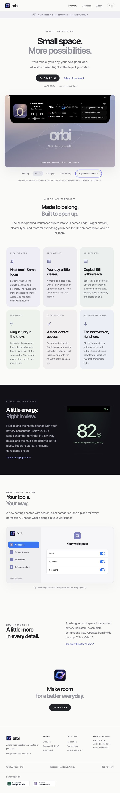
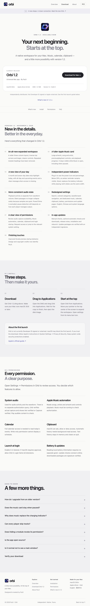

  
  <h1>Orbi</h1>
  
<strong>Small space. More possibilities.</strong>

  
Your music, your day, your next good idea. All a little closer. Right at the top of your Mac.

  
Designed & created by <strong>PaJii</strong>.

  
<a href="https://kaitangkevin.github.io/Orbi/">Explore the website</a> · <a href="https://kaitangkevin.github.io/Orbi/download/">Download Orbi</a> · <a href="https://kaitangkevin.github.io/Orbi/about/">About</a>

> **Now available: Orbi 1.2** · November 2, 2026 
> A larger workspace with curved screen-edge connections, a refreshed music layout, independent battery indicators, a redesigned settings center, and in-app updates. 
> [Discover the release →](https://kaitangkevin.github.io/Orbi/download/#whats-new) · [Get the latest version →](https://kaitangkevin.github.io/Orbi/download/)

## Meet Orbi

Orbi is a native macOS app that turns the space around your notch into a compact workspace. Keep music controls, calendar events, and recently copied text close at hand without opening a separate window for every small task.

It stays compact at the top of your screen and opens into a spacious panel when you need it. Larger artwork, clear typography, and curved connections to the screen edge make the workspace feel at home on your Mac.

[Explore Orbi on the official website →](https://kaitangkevin.github.io/Orbi/)

*The official website, featuring an interactive preview with sample music, calendar events, and clipboard content. The preview does not access visitors’ personal data.*

## A workspace within reach

### Music, without losing your place

See album artwork, the song title, and the artist beside playback controls and a progress bar. Skip to the previous or next track, pause, and resume from the expanded workspace.

The music card is available whenever Apple Music is open, including while paused. If no track is selected, Orbi shows a placeholder. Playback activity and audio level are handled separately, so a silent passage does not automatically mean playback has stopped.

In the compact view, the music indicator extends to either side of the notch. Apple Music supplies its playback state; detection for other players depends on their system audio activity and behavior.

### Your day, at a glance

A month label and seven-day date strip put today in context. The event list keeps all-day, ongoing, and upcoming calendar entries easy to scan, with clear times and calendar colors.

Calendar access is managed in settings. When access is unavailable, Orbi provides guidance to help you enable the feature.

### Copied text, still close by

Keep your last **15 copied text items** within reach. Select an item to copy it again, or clear the history when you are finished.

Clipboard history stays in running memory and clears when you quit Orbi. It is designed for quick reuse during your current session.

### Battery information that fits

Connect your charger to see a dedicated power indicator and battery percentage. When the battery drops below **20%**, an amber reminder keeps the low charge visible.

Charging and music use the same compact width, with distinct content. Music takes priority when playing; the battery indicator can return afterward if it still needs to be shown. The macOS charging chime is filtered out of music detection.

Charging and low-battery reminders each have their own settings switch.

## Make Orbi your own

The settings center brings search, category navigation, and feature controls together. A sidebar with colored icons, navigation controls, and clear sections makes preferences easy to find.

| Area | What you can manage |
|---|---|
| Workspace and appearance | Configure the workspace and available display preferences. |
| Music | Manage music integration and related behavior. |
| Calendar | Configure calendar functionality and review access. |
| Clipboard | Manage clipboard functionality and clear history. |
| Battery and alerts | Choose whether charging and low-battery reminders appear. |
| Permissions | Review access states and find relevant system settings. |
| Software Update | Check for a newer version and choose automatic update preferences. |

Orbi supports **English**, **Simplified Chinese**, and following the system language.

## Understand permissions

Orbi puts access information in one place, with request, refresh, verification, or system-settings actions where appropriate.

| Feature | Access information |
|---|---|
| System audio | Audio access is checked through actual capture verification. Silence alone is not treated as a permission failure. |
| Apple Music controls | Automation access allows Orbi to communicate with Apple Music. |
| Calendar events | Calendar access allows events to appear in the workspace. |
| Clipboard | Clipboard status and controls explain how copied text is used. |
| Start at login | Login startup status is available alongside the relevant controls. |

Some entries describe availability or verification rather than a separate macOS permission prompt. Review [the website’s permission guide](https://kaitangkevin.github.io/Orbi/download/#permissions) for setup details.

## Updates inside the app

Use **Settings → Software Update** or the menu-bar update action to check for a newer release. Automatic checks and downloads are optional. Supported updates can be downloaded, installed, and followed by a relaunch from inside Orbi.

Update archives are verified with Sparkle Ed25519 signatures. This update verification is separate from Apple Developer ID signing and notarization.

If your existing version predates the built-in updater, download the current app from the website and replace the old copy once. Subsequent updates can use the updater included in the app.

## Explore the website

The website is both a product introduction and a place to try Orbi’s interaction before installing it.

| Page or experience | What you will find |
|---|---|
| [Overview](https://kaitangkevin.github.io/Orbi/) | The product story, feature descriptions, and an interactive notch workspace. |
| Interactive workspace | Standby, music, charging, and low-battery previews; sample playback controls, track switching, and clipboard interactions. |
| Settings preview | Workspace, battery, permissions, and update sections. Module switches change the webpage demonstration. |
| [Download](https://kaitangkevin.github.io/Orbi/download/) | The current installer, compatibility information, package details, and checksum. |
| [Installation](https://kaitangkevin.github.io/Orbi/download/#install) | A step-by-step guide to installing and opening Orbi. |
| [Permissions](https://kaitangkevin.github.io/Orbi/download/#permissions) | An explanation of feature access and setup. |
| [Release notes](https://kaitangkevin.github.io/Orbi/download/#whats-new) | Detailed information about the latest release. |
| [FAQ](https://kaitangkevin.github.io/Orbi/download/#faq) | Answers about installation, playback detection, privacy, and updates. |
| [About](https://kaitangkevin.github.io/Orbi/about/) | Orbi and its creator, PaJii. |

The website supports English and Simplified Chinese, adapts to desktop and mobile screens, and includes DailyLaunch and MacNative listings. All interactive demonstrations use sample content and affect only the webpage.

<strong>See the download page screenshot</strong>

## Get started

**[Download Orbi from the official website →](https://kaitangkevin.github.io/Orbi/download/)**

| Requirement | Details |
|---|---|
| Operating system | macOS 26.6 or later |
| Mac architecture | Universal app for Apple silicon and Intel |
| Installer | DMG disk image |
| App languages | English and Simplified Chinese, with a system-language option |

1. Download the installer from the official website and open the DMG.
2. Drag **Orbi** into **Applications**. Quit an existing copy first if you are replacing it.
3. Open Orbi and review the feature and permission settings you want to use.

Orbi is independently distributed outside the Mac App Store. The current distribution is not Developer ID signed or Apple notarized. Consult the [installation guide](https://kaitangkevin.github.io/Orbi/download/#install) for first-launch information and package verification.

## Questions and feedback

Visit the [FAQ](https://kaitangkevin.github.io/Orbi/download/#faq) for help with installation, permissions, music detection, clipboard behavior, and updates. When reporting an issue, include your macOS version and the steps that produced it. Avoid sharing private calendar entries, clipboard text, or other personal information.

## About this repository

This repository contains the public website, documentation, screenshots, downloadable app binaries, and update metadata. **The native Orbi application source code is not public.**

Downloads and user-facing documentation link to the official website. The native app’s Swift files, Xcode project, signing keys, certificates, and development data are not included here.

## Created by PaJii

Orbi is designed and created by **PaJii**, with a focus on making everyday tools feel close, clear, and natural on the Mac.

[Meet Orbi and PaJii →](https://kaitangkevin.github.io/Orbi/about/)

**© 2026 PaJii · Orbi. All rights reserved.**

Orbi is an independent application and is not affiliated with Apple. Apple, Mac, macOS, and Apple Music are trademarks used to describe platform compatibility and integration.
